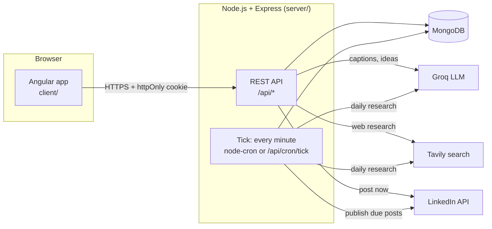
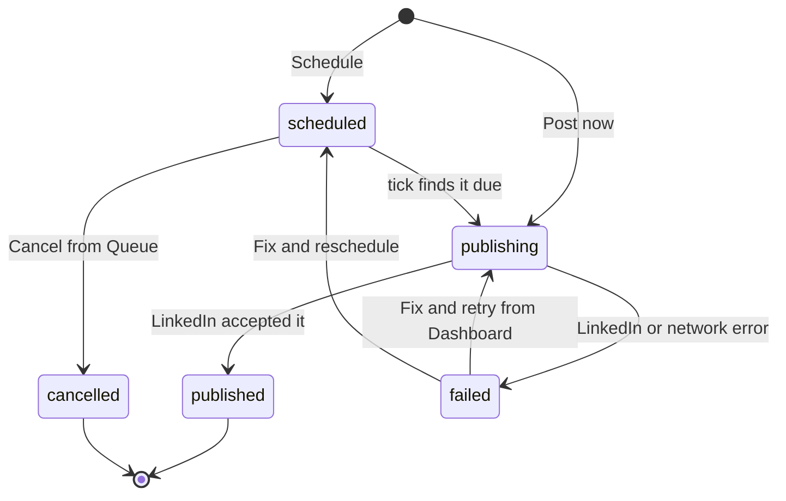

<div align="center">


# LinkedIn Automation

**A personal studio for writing, scheduling and tracking LinkedIn posts with AI.**
Research what's trending in your niche, turn an idea into a caption in your own voice, preview it exactly as the feed will show it, then post now or schedule it.

Angular 16 · Node.js + Express · MongoDB · Groq (LLM) · Tavily (web search) · LinkedIn API

</div>


---

## Contents

1. [What it does](#1-what-it-does)
2. [Screenshots](#2-screenshots)
3. [How it works](#3-how-it-works)
4. [Tech stack](#4-tech-stack)
5. [Project structure](#5-project-structure)
6. [Before you start: accounts and keys](#6-before-you-start-accounts-and-keys)
7. [Run it locally, step by step](#7-run-it-locally-step-by-step)
8. [Environment variables](#8-environment-variables)
9. [Using the app](#9-using-the-app)
10. [API reference](#10-api-reference)
11. [Deploying to Vercel](#11-deploying-to-vercel)
12. [Guide for AI coding agents and contributors](#12-guide-for-ai-coding-agents-and-contributors)
13. [Troubleshooting](#13-troubleshooting)
14. [Known limitations](#14-known-limitations)

---

## 1. What it does

This is a **single-user** tool: it always posts as one LinkedIn account (yours), and a username/password login keeps everyone else out.

| Feature | What you get |
|---|---|
| **Login** | One username and password (set on the server). The session cookie lasts 7 days. Every page and API route is protected. |
| **Ideas (research)** | Every day at a time you choose, the app searches the web for what's trending in your niche (Tavily) and asks an LLM (Groq) for post ideas: why it's trending now, an angle and key facts, with source links. You can also click **Get fresh ideas** at any time. |
| **Compose** | Pick a format, describe the post (or start from an idea), and the AI drafts the caption. Edit it freely. A live **feed preview** shows how it will look, including where LinkedIn cuts it off with "…more". |
| **Three post formats** | **Text only** · **Text + images** (attach up to 5 of your own) · **Text + image prompts** (the AI writes one image-generation prompt per image; you make the images in any AI image tool and upload them into their slots). |
| **Post now or schedule** | Publish straight away, or pick a date and time. A scheduler checks every minute and publishes on time. |
| **Queue** | Every scheduled post, soonest first. Edit the caption, images or time, or cancel. |
| **Dashboard** | Totals (created, published, scheduled, failed, cancelled), a breakdown by format and by source, every post with filters, and the last 10 activities. Failed posts can be fixed and retried. |
| **Settings** | 6 colour themes plus fully custom colours, with live contrast ratios. The theme is saved on the server so it follows you to every browser. |
| **Responsive** | A left sidebar on desktop, and a top bar with a drop-down menu on phones and tablets. |

---

## 2. Screenshots

| Login | Ideas |
|---|---|
|  |  |
| **Queue** | **Dashboard** |
|  |  |
| **Settings** | **Mobile** |
|  |   |

---

## 3. How it works

### The big picture



- The **client** is an Angular single-page app. It never talks to LinkedIn, Groq or Tavily directly; everything goes through the server.
- The **server** is an Express API. It holds every secret (API keys, LinkedIn token) in environment variables.
- **MongoDB** stores posts, scheduled images, idea batches, the activity log, settings and the author profile.
- The **tick** is the one place time-based work happens. Every minute it publishes posts that are due, and starts the daily research when its time comes. Locally, `node-cron` runs it; on serverless hosts an external pinger calls `/api/cron/tick`.

### Life of a post



- A post is **saved before it is sent**, so a failed "Post now" is never lost. It shows up as *failed* on the Dashboard with the reason.
- `publishing` is a short **claim state**. The scheduler flips `scheduled → publishing` in a single atomic MongoDB update before calling LinkedIn, so two overlapping ticks (or two server instances) can never publish the same post twice.
- Images for posts that are not on LinkedIn yet (scheduled or failed) are stored **in MongoDB** (`ScheduledImage`), not on disk, so it works on hosts without a persistent filesystem. They're deleted once the post is published or cancelled.
- Every publish attempt goes through one function (`publishPostRecord` in `server/src/services/postRecordService.js`), so each leaves the same trail: status, failure reason and an activity entry.

### Research and ideas

1. The **author profile** (a single MongoDB document, seeded from `server/src/config/defaultProfile.js` on first use) lists trending topics, evergreen topics, opinions, and the only personal facts the AI may claim.
2. A research run searches **Tavily** for each trending topic plus one rotating evergreen topic.
3. **Groq** turns the articles into ideas (usually 2 trending + 1 evergreen), each with a topic, why it's trending, an angle, key facts and sources.
4. Ideas are saved as an `IdeaBatch`, which expires automatically after 30 days.
5. When you open an idea in Compose (each idea card links to every format, with the AI's suggested one marked), Compose sends that idea's stored research with the request, so the caption is grounded in real sources without searching again.

The daily run is claimed atomically too (`lastScheduledRunDate` in `AppSettings`), so it happens once a day even if ticks overlap.

### API key failover

Groq and Tavily each accept a **primary and a backup key** (`GROQ_API_KEY` / `GROQ_API_KEY2`, `TAVILY_API_KEY` / `TAVILY_API_KEY2`). `server/src/utils/keyPool.js` always tries the primary first. If it's rate-limited, out of credit or the provider is down, it pauses that key for a while and switches to the backup. If the request itself is bad, it fails straight away, because the backup would fail the same way.

### Login and security

- `POST /api/auth/login` checks `APP_USERNAME` / `APP_PASSWORD`, using a comparison that takes the same time whether or not the guess is close.
- On success it sets an **httpOnly cookie** `app_session`: a JWT signed with `JWT_SECRET`, valid for **7 days**, and unreadable by page scripts.
- Every app route is wrapped in `requireLogin` (`server/src/middleware/auth.js`). Only `/api/auth/*`, `/api/cron/tick` (which has its own secret) and `/health` are open.
- After 10 failed logins from one IP address, login is blocked for 15 minutes.
- On the client, a route guard sends logged-out visitors to `/login`, and an HTTP interceptor sends you back there if any request returns 401 (for example, when the cookie expires).
- If `APP_USERNAME` or `APP_PASSWORD` is missing, **nobody can log in**; the app is never left open by accident.

---

## 4. Tech stack

| Layer | Technology |
|---|---|
| Frontend | Angular 16 (NgModules, lazy-loaded feature modules), RxJS, plain CSS with design tokens (CSS custom properties) |
| Backend | Node.js (ES modules), Express 4, Mongoose 9, Multer (uploads), Helmet, CORS, cookie-parser, jsonwebtoken, node-cron |
| Database | MongoDB (Atlas or local) |
| AI | [Groq](https://console.groq.com) chat completions (model set by `GROQ_MODEL`, default `openai/gpt-oss-20b`) |
| Web search | [Tavily](https://tavily.com) |
| Publishing | LinkedIn "Share on LinkedIn" API (`/v2/ugcPosts`, `/v2/assets`) |
| Hosting | Vercel (client and server as separate projects), or any Node host |

---

## 5. Project structure

```
LinkedInAutomation/
├── README.md                     ← you are here
├── docs/screenshots/             ← images used in this README
│
├── client/                       ← Angular app
│   ├── .env.example              ← API_URL (backend origin)
│   ├── scripts/set-env.js        ← writes env.generated.ts from API_URL before every build
│   ├── vercel.json               ← SPA rewrites for Vercel
│   └── src/
│       ├── index.html            ← favicon, fonts
│       ├── styles.css            ← global design tokens, buttons, inputs, icons
│       ├── assets/               ← logo, icons, profile photo
│       └── app/
│           ├── app-routing.module.ts      ← routes + auth guards
│           ├── app.component.*            ← shell: nav rail + page outlet + page-change loader
│           ├── auth/                      ← /login page
│           ├── compose/                   ← /compose  (write a post)
│           ├── schedule/                  ← /ideas    (research + idea cards)
│           ├── queue/                     ← /queue    (scheduled posts)
│           ├── dashboard/                 ← /dashboard (+ post-editor drawer)
│           ├── settings/                  ← /settings (themes)
│           ├── core/
│           │   ├── config/api-config.ts   ← API_BASE_URL
│           │   ├── guards/auth.guard.ts   ← authGuard / guestGuard
│           │   ├── interceptors/          ← adds credentials, handles 401
│           │   ├── models/                ← TypeScript interfaces + labels
│           │   └── services/              ← auth, post, idea, dashboard, theme
│           └── shared/components/
│               ├── nav-bar/               ← sidebar / mobile top bar, logout
│               ├── loader/                ← animated JP loader (sm / md / lg)
│               └── theme-picker/
│
└── server/                       ← Express API
    ├── .env.example              ← every server variable, documented
    └── src/
        ├── server.js             ← local entry: connect DB, backfill, start cron, listen
        ├── app.js                ← Express app (also the Vercel entry): middleware + routes
        ├── config/
        │   ├── env.js            ← reads and documents every env variable
        │   ├── db.js             ← one shared Mongo connection
        │   └── defaultProfile.js ← seed for the author profile
        ├── middleware/auth.js    ← requireLogin (app) / requireAuth (LinkedIn OAuth)
        ├── models/               ← Post, ScheduledImage, IdeaBatch, Activity,
        │                            AppSettings, AuthorProfile, User
        ├── routes/               ← auth, posts, ideas, dashboard, settings, users, cron
        ├── services/
        │   ├── aiService.js          ← Groq prompts: captions, image prompts
        │   ├── ideaService.js        ← research pipeline (Tavily → Groq → IdeaBatch)
        │   ├── tavilyService.js      ← web search
        │   ├── linkedinService.js    ← LinkedIn OAuth, image upload, create post
        │   ├── publishService.js     ← the one path that posts to LinkedIn
        │   ├── postRecordService.js  ← publish attempt bookkeeping + atomic claim
        │   ├── activityService.js    ← activity log
        │   └── profileService.js     ← author profile + app settings singletons
        ├── jobs/
        │   ├── scheduler.js          ← node-cron, every minute → tick
        │   ├── tick.js               ← publish due posts + daily research
        │   ├── scheduledPostRunner.js
        │   ├── researchRunner.js
        │   └── backfillPosts.js      ← fills new fields on old posts at startup
        ├── utils/
        │   ├── keyPool.js            ← primary/backup API key failover
        │   ├── crypto.js             ← AES-256-GCM for stored OAuth tokens
        │   └── zonedTime.js          ← "what time is it in Asia/Kolkata"
        └── scripts/testLinkedInPost.js  ← manual one-off LinkedIn check
```

---

## 6. Before you start: accounts and keys

You need **Node.js 18 or newer** (developed on Node 22) and **npm**. Then collect these:

| # | What | Where to get it | Used for |
|---|---|---|---|
| 1 | **MongoDB connection string** | [MongoDB Atlas](https://www.mongodb.com/atlas) free cluster, or local `mongodb://127.0.0.1:27017/linkedin-automation` | All data |
| 2 | **LinkedIn access token + Person URN** | See [Getting the LinkedIn token](#getting-the-linkedin-token-and-person-urn) below | Publishing posts |
| 3 | **Groq API key** (starts with `gsk_`) | [console.groq.com/keys](https://console.groq.com/keys) (free tier works) | Captions, image prompts, ideas |
| 4 | **Tavily API key** (starts with `tvly-`) | [app.tavily.com](https://app.tavily.com) (free tier works) | Daily research |
| 5 | Two long random strings | Run `node -e "console.log(require('crypto').randomBytes(32).toString('hex'))"` twice | `JWT_SECRET`, `TOKEN_ENCRYPTION_KEY` |

### Getting the LinkedIn token and Person URN

The app posts with LinkedIn's self-serve **Share on LinkedIn** product, which needs no partner review.

1. Go to the [LinkedIn Developer Portal](https://www.linkedin.com/developers/apps) and create an app. It must be linked to a LinkedIn Page; any page you admin will do.
2. Under **Products**, add **Share on LinkedIn** and **Sign In with LinkedIn using OpenID Connect**.
3. Under **Auth**, copy the **Client ID** and **Client Secret**, and add a redirect URL (for example `http://localhost:3000/api/auth/linkedin/callback`, or your Postman callback).
4. Get a **3-legged access token** with the scopes `openid profile email w_member_social`. The easiest way is LinkedIn's [OAuth token generator](https://www.linkedin.com/developers/tools/oauth/token-generator) or Postman. Tokens last about 60 days.
5. Call `GET https://api.linkedin.com/v2/userinfo` with `Authorization: Bearer <token>`. The `sub` field is your member ID.
6. Your Person URN is `urn:li:person:<sub>`.
7. Put the token in `LINKEDIN_ACCESS_TOKEN` and the URN in `LINKEDIN_PERSON_URN`.

> When the token expires (about every 60 days), publishing starts failing with a 401 from LinkedIn. Generate a new token and update the variable.

---

## 7. Run it locally, step by step

### Step 1: Clone

```bash
git clone <your-repo-url> LinkedInAutomation
cd LinkedInAutomation
```

### Step 2: Configure and start the server

```bash
cd server
npm install
cp .env.example .env          # Windows PowerShell: Copy-Item .env.example .env
```

Open `server/.env` and fill in at least:

```dotenv
PORT=3000
CLIENT_URL=http://localhost:4200
MONGO_URI=<your MongoDB connection string>
JWT_SECRET=<long random string>
TOKEN_ENCRYPTION_KEY=<another long random string>
APP_USERNAME=<choose a username>
APP_PASSWORD=<choose a strong password>
LINKEDIN_ACCESS_TOKEN=<token from section 6>
LINKEDIN_PERSON_URN=urn:li:person:<your sub>
GROQ_API_KEY=<gsk_...>
TAVILY_API_KEY=<tvly-...>
```

Then start it:

```bash
npm run dev                   # auto-restarts on file changes (nodemon)
# or: npm start
```

You should see:

```
[db] connected
[scheduler] started - checking every minute for due posts and the daily research time
[server] listening on http://localhost:3000
```

Check it: open http://localhost:3000/health, which should return `{"status":"ok"}`.

### Step 3: Configure and start the client

In a second terminal:

```bash
cd client
npm install
cp .env.example .env
```

Edit `client/.env` so the **local** line is the active one:

```dotenv
# API_URL=https://your-production-backend.vercel.app
API_URL=http://localhost:3000
```

Then:

```bash
npm start                     # runs set-env.js, then ng serve
```

### Step 4: Log in

Open **http://localhost:4200**. You'll be sent to `/login`. Enter the `APP_USERNAME` and `APP_PASSWORD` you set in step 2.

### Step 5: Make it yours

- **Author profile:** edit `server/src/config/defaultProfile.js` with your own name, audience, topics, opinions and **true** facts about your work. It is copied into MongoDB the first time it's read, so if a profile already exists, edit or delete the `authorprofiles` document instead.
- **Preview photo and link:** replace `client/src/assets/profile_img.jpg` (a square image of 256 pixels or more works best), and change the portfolio link in `client/src/app/compose/compose.component.html`.
- **Logo and favicon:** `client/src/assets/logo.png`, `client/src/favicon.ico`, `client/src/assets/icon-192.png`, `client/src/assets/apple-touch-icon.png`.
- **Daily research time:** set it on the Ideas page. It's interpreted in `RESEARCH_TIMEZONE`.

### Step 6 (optional): Test LinkedIn on its own

```bash
cd server
node src/scripts/testLinkedInPost.js
```

⚠️ This publishes a **real, visible** post to your LinkedIn account.

---

## 8. Environment variables

### Server (`server/.env`)

| Variable | Required | Example / default | What it does |
|---|---|---|---|
| `PORT` | no | `3000` | Port for the API. |
| `CLIENT_URL` | yes | `http://localhost:4200` | Frontend origin(s) allowed by CORS, comma-separated, no trailing slash. If it starts with `https://`, cookies switch to `SameSite=None; Secure` for cross-site deploys. |
| `MONGO_URI` | yes | `mongodb+srv://...` | MongoDB connection string. |
| `JWT_SECRET` | yes | 64 hex characters | Signs the login cookie. **Changing it logs everyone out.** |
| `TOKEN_ENCRYPTION_KEY` | yes | long random string | Encrypts LinkedIn OAuth tokens stored in MongoDB. |
| `APP_USERNAME` | yes | — | Login username. Named `APP_` because Windows already defines `USERNAME`. |
| `APP_PASSWORD` | yes | — | Login password. Use a strong one. |
| `LINKEDIN_ACCESS_TOKEN` | yes | — | The token every post is published with. |
| `LINKEDIN_PERSON_URN` | yes | `urn:li:person:abc123` | The account posts are published as. |
| `LINKEDIN_CLIENT_ID` / `LINKEDIN_CLIENT_SECRET` | only for OAuth | — | Only used by the optional `/api/auth/linkedin` OAuth routes. |
| `LINKEDIN_REDIRECT_URI` | only for OAuth | `http://localhost:3000/api/auth/linkedin/callback` | OAuth callback. |
| `LINKEDIN_API_VERSION` | no | `202601` | `YYYYMM` version for the analytics call only. |
| `GROQ_API_KEY` | yes | `gsk_...` | Primary Groq key. |
| `GROQ_API_KEY2` | no | `gsk_...` | Backup Groq key. |
| `GROQ_MODEL` | no | `openai/gpt-oss-20b` | Groq model id. Groq retires models often; change it here if you get "decommissioned" errors. |
| `TAVILY_API_KEY` | for research | `tvly-...` | Primary Tavily key. |
| `TAVILY_API_KEY2` | no | `tvly-...` | Backup Tavily key. |
| `RESEARCH_TIMEZONE` | no | `Asia/Kolkata` | Timezone for the daily research time. |
| `CRON_SECRET` | on serverless | long random string | Enables `/api/cron/tick`. Leave empty locally. |
| `PIXAZO_API_KEY` | no | — | Read by the config but not used by any feature yet. |

### Client (`client/.env`)

| Variable | Required | Example | What it does |
|---|---|---|---|
| `API_URL` | yes | `http://localhost:3000` | Backend origin, **without** `/api` or a trailing slash. `scripts/set-env.js` turns it into `src/app/core/config/env.generated.ts` before every `start`, `build`, `watch` and `test`. The build stops if it's missing. |

> Never commit `.env` files. Both `.gitignore` files already exclude them, along with `env.generated.ts`.

---

## 9. Using the app

### Compose (`/compose`)

1. **Format:** choose *Text only*, *Text + images* or *Text + image prompts*.
2. **Brief:** describe the post in a sentence or two, for example "Wrapping up a project migrating our backend to microservices". For *Text + image prompts*, also choose how many images (1 to 5).
3. Click **Generate caption**. The animated loader shows while the AI writes. The caption appears in step 03, where you can edit it.
4. **Media:**
   - *Text + images*: add up to 5 JPEG, PNG or WEBP files, 10 MB each at most. No GIFs or video.
   - *Text + image prompts*: copy each prompt into your AI image tool, then upload the result into its slot. Only filled slots are posted.
5. **Preview:** the right-hand card shows the post as it will appear in the feed, and "Before it goes out" lists checks such as the 3,000-character limit and missing images.
6. **Publish:** choose **Post now**, or **Schedule** and pick a time at least 2 minutes ahead.

### Ideas (`/ideas`)

- Shows the latest researched ideas: trending and evergreen, each with why it matters now, an angle, key facts and sources.
- **Get fresh ideas** runs research immediately (up to about 30 seconds).
- **Daily research**: set the time and click **Save time**.
- Under each idea, pick a format (the AI's choice is marked **Suggested**) to open Compose with that idea's research attached.

### Queue (`/queue`)

Scheduled posts, soonest first. **Edit** changes the caption, images or time (or posts it now); **Cancel** stops it from going out, while keeping a record.

### Dashboard (`/dashboard`)

Totals, breakdowns, every post (filter by status and format), and the 10 most recent activities. Open a **failed** post to see why it failed, fix it, and retry or reschedule.

### Settings (`/settings`)

Choose one of six presets (Kiln, Paper, Harbor, Press, Midnight, Conifer) or set custom background, text and accent colours. Contrast ratios are shown live.

### Logging out

Click **Log out** at the bottom of the sidebar (desktop) or the menu (mobile).

---

## 10. API reference

Base URL: `<server>/api`. Every route except those marked **open** needs the `app_session` cookie, sent automatically by the browser with `withCredentials`.

| Method | Path | Purpose |
|---|---|---|
| POST | `/auth/login` **open** | `{ username, password }` → sets the 7-day cookie. 401 on wrong credentials, 429 after too many failures. |
| GET | `/auth/session` **open** | `{ authenticated, username? }` |
| POST | `/auth/logout` **open** | Clears the cookie. 204. |
| GET | `/posts?status=&type=` | List posts. `status=scheduled` returns soonest first; everything else newest first. |
| POST | `/posts/generate-caption` | `{ description, idea? }` → `{ caption }`. `idea` points at a stored idea, whose research grounds the caption. |
| POST | `/posts/generate-caption-and-prompts` | Same, plus `imageCount` → `{ caption, imagePrompts[] }` |
| POST | `/posts` | Multipart: `description`, `caption`, `postType`, `images[]` (0–5), optional `imagePrompts[]`, `ideaBatchId` / `ideaIndex`, `scheduledFor` (ISO). Posts now, or schedules when `scheduledFor` is set. |
| GET | `/posts/:id/images/:order` | Stored image bytes for an unpublished post. |
| PUT | `/posts/:id` | Edit or fix a scheduled or failed post: caption, `layout`, `images[]`, `scheduledFor` or `publishNow`. |
| DELETE | `/posts/:id` | Cancel a scheduled post. The record is kept as `cancelled`. |
| GET | `/ideas` | Latest finished batch, latest run of any outcome, and research settings. |
| POST | `/ideas/refresh` | Run research now and wait for it (about 10–30 s). |
| PUT | `/ideas/settings` | `{ researchTime: "HH:mm" }` |
| GET | `/ideas/:batchId/:index` | One idea, for Compose. |
| GET | `/dashboard` | Totals, breakdowns, and the last 10 activities. |
| GET / PUT | `/settings/theme` | Read or save the app theme. |
| GET/POST | `/cron/tick` **own secret** | Runs one tick. Needs `Authorization: Bearer <CRON_SECRET>` or `x-cron-secret`. Returns 503 if `CRON_SECRET` is unset. |
| GET | `/health` **open** (not under `/api`) | `{ status: "ok" }` |

There are also optional LinkedIn OAuth routes (`/auth/linkedin`, `/auth/linkedin/callback`, `/auth/me`, `/users/me`), kept for future multi-user support and gated behind the login, plus two dev-only test routes (`/posts/test-text`, `/posts/test-image`).

---

## 11. Deploying to Vercel

The client and server are deployed as **two separate Vercel projects** from the same repository.

### Server project

1. In Vercel, create a project with **Root Directory** `server`. Vercel detects the Express app from `src/app.js`, which exports the app; `server.js` is only used locally.
2. Add every variable from [section 8](#8-environment-variables), with `CLIENT_URL` set to your client's URL (for example `https://your-client.vercel.app`).
3. Set `CRON_SECRET` to a long random string.
4. **Schedule the tick.** Serverless functions don't run `node-cron`, so something must call the tick every minute:
   - an external pinger such as [cron-job.org](https://cron-job.org), calling `GET https://<server>/api/cron/tick` with the header `Authorization: Bearer <CRON_SECRET>` every minute; or
   - Vercel Cron, although per-minute schedules need a paid plan.

   Without this, scheduled posts and the daily research will not run.
5. In MongoDB Atlas, allow connections from anywhere (`0.0.0.0/0`), because Vercel's IP addresses change.

### Client project

1. Create a second project with **Root Directory** `client`. `vercel.json` already sets the build command and the rewrite that makes deep links like `/dashboard` work.
2. Add the environment variable `API_URL=https://<your-server>.vercel.app`.
3. Deploy.

### Cookies across domains

The client and server live on different domains, so the login cookie is sent cross-site. The server handles this automatically when `CLIENT_URL` starts with `https://`, by using `SameSite=None; Secure`. Browsers that block all third-party cookies (Safari by default, or Chrome with that setting turned on) will refuse it. If you see a login loop, serve both from one domain (for example, a custom domain for each under the same parent) or proxy `/api` through the client project.

---

## 12. Guide for AI coding agents and contributors

Read this before changing code.

### Ground rules

- **Single user, by design.** There is no per-user scoping of posts. `User` and the LinkedIn OAuth routes exist for a possible future, but nothing in the posting flow depends on them.
- **Never weaken auth.** New API routers must be mounted behind `requireLogin` in `server/src/app.js`. New pages must have `canActivate: [authGuard]` in `client/src/app/app-routing.module.ts`. The OAuth `session` cookie is deliberately **not** enough to get in; only the `app_session` cookie with `scope: "app"` is.
- **All publishing goes through `publishPostRecord()`** (`server/src/services/postRecordService.js`), and every move into `publishing` goes through `claimForPublishing()`. Don't call `publishToLinkedIn()` directly from a route or job, or you lose the double-publish protection and the activity trail.
- **All time-based work goes through `runTick()`** (`server/src/jobs/tick.js`) so it works both under `node-cron` and the serverless `/api/cron/tick`.
- **Truthfulness:** `facts` in the author profile are the only personal experiences the AI may claim. Keep them strictly true. The prompts in `aiService.js` are deliberately long and explicit; read the comments before trimming them.
- **Secrets stay on the server.** The client only knows `API_URL`.

### Where to change what

| I want to… | Edit |
|---|---|
| Change caption style or prompts | `server/src/services/aiService.js` |
| Change research topics or idea count | Author profile (`defaultProfile.js` / the `authorprofiles` document) and `server/src/services/ideaService.js` |
| Add a post field | `server/src/models/Post.js`, `client/src/app/core/models/post.model.ts`, and `backfillPosts.js` if old posts need a value |
| Add a page | New lazy module under `client/src/app/<name>/`, a route with `authGuard`, and a link in `shared/components/nav-bar/nav-bar.component.ts` |
| Add an API route | A router under `server/src/routes/`, mounted with `requireLogin` in `app.js` |
| Change colours or spacing | Tokens at the top of `client/src/styles.css`. Components only use `var(--color-…)`, never hard-coded colours. |
| Show a loading state | `<app-loader size="lg" label="…" block>` for a page, `size="md"` for a section, `size="sm"` inside a button (from `SharedModule`) |
| Change the login lifetime | `LOGIN_DAYS` in `server/src/routes/authRoutes.js` |
| Change how many activities show | `RECENT_ACTIVITY` in `server/src/routes/dashboardRoutes.js` |

### Conventions

- **Server:** ES modules, `async` route handlers (errors reach the central handler via `express-async-errors`), and errors returned as `{ error: "message" }`.
- **Client:** NgModules (not standalone components), `strictTemplates` on, a service per resource in `core/services`, and one CSS file per component.
- **Comments explain *why*, not what.** Match the existing density.
- **Type-check the client:** `cd client && npx ngc -p tsconfig.app.json --noEmit`. This catches template errors that plain `tsc` misses.
- There is no automated test suite yet. Verify changes by running both apps and using the feature.

### Gotchas

- `client/src/app/core/config/env.generated.ts` is **generated**. Don't edit it; set `API_URL`.
- If `client/.env` points at production, your local client talks to the **production** API.
- `JWT_SECRET` signs the login cookie; rotating it logs everyone out.
- Some older posts have no `content.text`. Treat captions as possibly missing (see `excerpt()` in `core/models/post-labels.ts`).
- On Windows, never name an env variable `USERNAME`: the system value wins over `.env`.

---

## 13. Troubleshooting

| Symptom | Likely cause and fix |
|---|---|
| Client build stops with `API_URL is not set` | Create `client/.env` with an `API_URL` line. |
| Login page says "Could not reach the server" | Backend isn't running, or `API_URL` is wrong. Check `http://localhost:3000/health`. |
| "Login is not configured" (503) | Set `APP_USERNAME` and `APP_PASSWORD` in `server/.env` and restart the server. |
| "Too many failed attempts" (429) | 10 wrong passwords from your IP address. Wait 15 minutes or restart the server. |
| Logged in, but immediately sent back to `/login` (deployed) | The browser is blocking the cross-site cookie. See [Cookies across domains](#cookies-across-domains), and check that `CLIENT_URL` matches the client URL exactly. |
| CORS error in the console | `CLIENT_URL` doesn't match the origin you opened, including the port. No trailing slash. |
| Posting fails with 401 from LinkedIn | `LINKEDIN_ACCESS_TOKEN` expired (about 60 days). Generate a new one. |
| Caption generation fails with "decommissioned" or 404 | Groq retired the model. Set `GROQ_MODEL` to a current one from [console.groq.com/docs/models](https://console.groq.com/docs/models). |
| Scheduled posts never go out (deployed) | Nothing is calling `/api/cron/tick`. See [Deploying](#server-project). |
| Daily research didn't run | It only starts within 15 minutes after the set time, once per day. Check `RESEARCH_TIMEZONE` and the time on the Ideas page. |
| `MongoServerSelectionError` | Wrong `MONGO_URI`, or your IP address isn't allowed in Atlas → Network Access. |

---

## 14. Known limitations

- **One LinkedIn account, one login.** Not multi-user.
- **The LinkedIn token is manual** and must be refreshed about every 60 days.
- **Minute-level scheduling.** A post goes out within about a minute of its time.
- **No automated tests** yet.
- **Analytics** (impressions, reactions) exist in the data model and LinkedIn service but aren't shown in the UI yet.
- `PIXAZO_API_KEY` is reserved for a future in-app image generator and currently unused.

---

<div align="center">

Built by **[Jeetu Prasad](https://www.jeetuprasad.in)**

</div>
