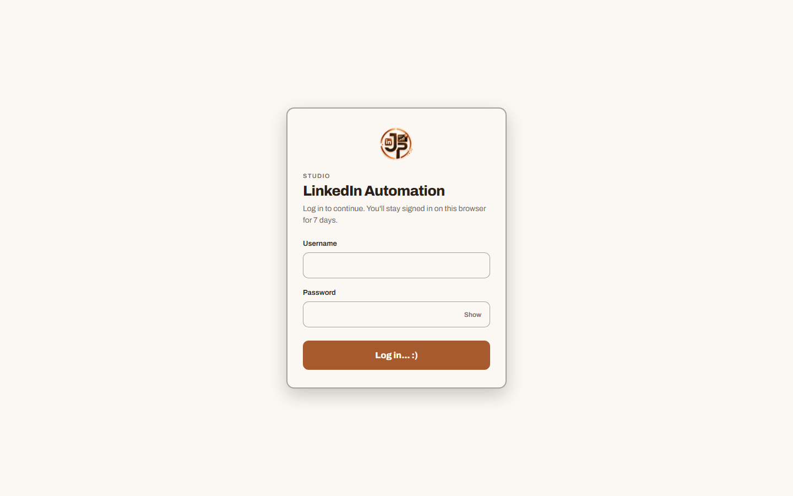
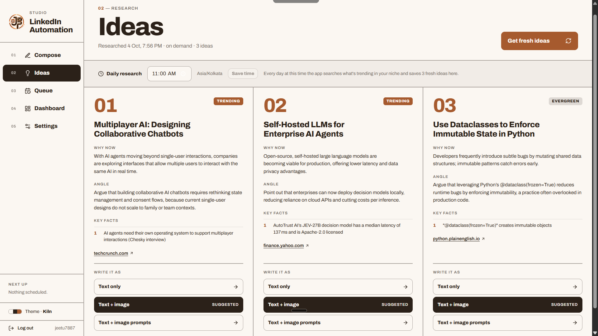
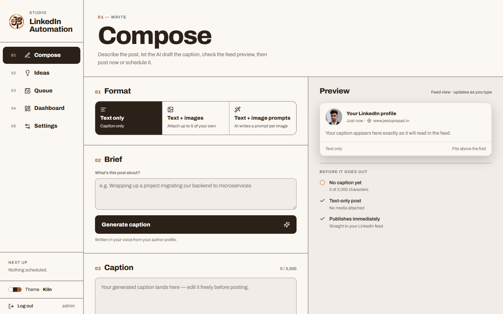
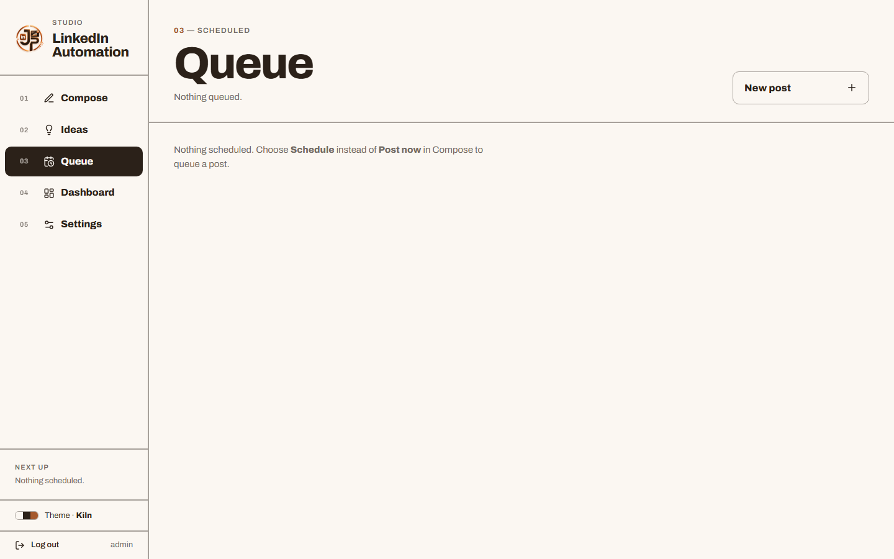
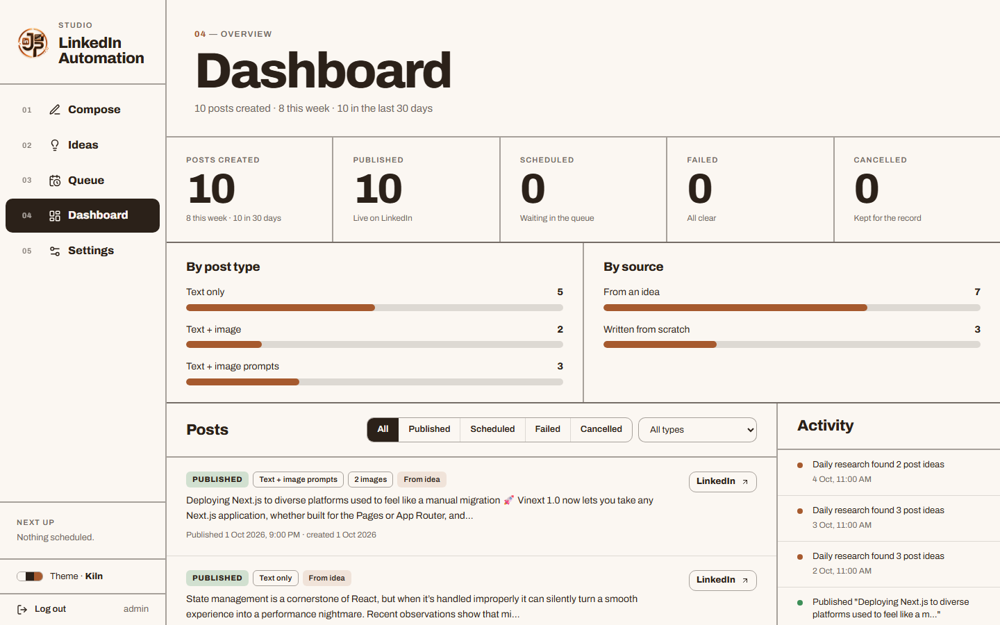
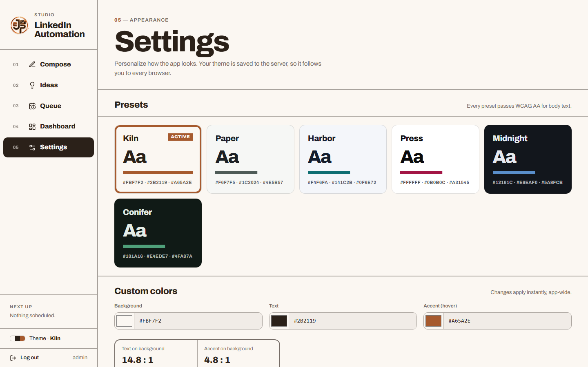
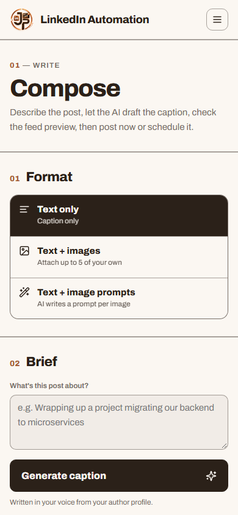
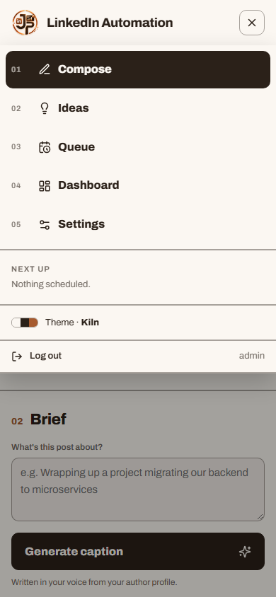
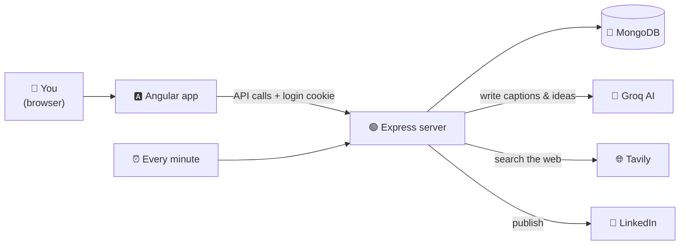
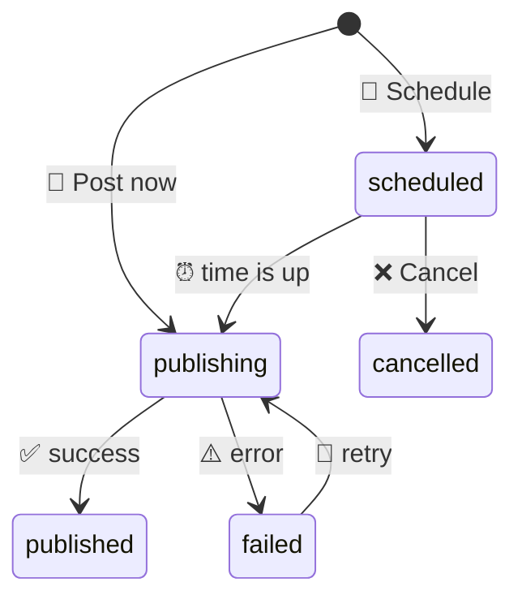

<div align="center">


# ✍️ LinkedIn Automation Studio

**Research → Write → Schedule → Track: your LinkedIn posts, done with AI.**

*Write in your own voice, post on time.*

[](https://angular.dev/)
[](https://nodejs.org/)
[](https://www.mongodb.com/atlas)
[](https://console.groq.com/)
[](https://tavily.com/)
[](https://learn.microsoft.com/en-us/linkedin/)
[](https://vercel.com/)

</div>

---

## ✨ What is it?

Posting on LinkedIn regularly is hard. You have to find a topic, write it well, and remember to post.

This app does the heavy lifting:

> 🔎 **Finds** what's trending in your field every day<br/>
> ✍️ **Writes** the caption in your voice<br/>
> 👀 **Shows** exactly how it will look in the feed<br/>
> ⏰ **Posts** it now, or at the time you pick<br/>
> 📊 **Tracks** everything you've published

It's a **personal, single-user** tool: it posts to *your* LinkedIn account, and a login keeps everyone else out.

---

## 🌟 Features

### 🔐 Private login

One username and password, set on the server. You stay logged in for **7 days**, and every page and API route is protected.

<div align="center">

</div>

---

### 💡 Ideas: daily AI research

Every day at the time you choose, the app:

1. 🌐 searches the web for news in your niche (**Tavily**)
2. 🧠 asks an AI (**Groq**) to turn it into post ideas
3. 📝 shows each idea with **why it's trending**, an **angle**, **key facts** and **sources**

Need ideas right now? Click **Get fresh ideas**.

<div align="center">

</div>

---

### ✍️ Compose: write with AI

Pick a format, describe the post in one line, and click **Generate caption**.

| Format | What happens |
|:---|:---|
| 📝 **Text only** | The AI writes the caption |
| 🖼️ **Text + images** | Attach up to 5 of your own images |
| 🎨 **Text + image prompts** | The AI writes an image prompt for each slot; you create the images in any AI tool and upload them |

The **live preview** on the right shows the post exactly as the feed will, including where LinkedIn cuts it off with "…more", plus a checklist before it goes out.

<div align="center">

</div>

---

### ⏰ Queue: schedule posts

Choose **Post now** or **Schedule**. A scheduler checks every minute and publishes on time.
From the Queue you can ✏️ **edit** the caption, images or time, or ❌ **cancel** a post.

<div align="center">

</div>

---

### 📊 Dashboard: track everything

- 🔢 Totals: created, published, scheduled, failed, cancelled
- 📈 Breakdowns by format and by source
- 🗂️ Every post, with filters
- 🕒 The last 10 activities
- 🔁 Failed posts can be **fixed and retried**: nothing is ever lost

<div align="center">

</div>

---

### 🎨 Settings: themes

6 ready-made themes (**Kiln, Paper, Harbor, Press, Midnight, Conifer**) or your own colours, with live contrast scores. The theme is saved on the server, so it follows you to every browser.

<div align="center">

</div>

---

### 📱 Works on every screen

A sidebar on desktop, and a top bar with a menu on mobile. There's also a custom animated **JP loader** wherever something is loading.

<div align="center">

&nbsp;&nbsp;

</div>

---

## 🧠 How it works



**In plain words:**

- 🅰️ The **Angular app** is what you see. It only talks to our server, never to the AI or to LinkedIn directly.
- 🟢 The **Express server** holds all the secret keys and does the real work.
- 🍃 **MongoDB** stores posts, ideas, settings and the activity log.
- ⏰ **Every minute** a "tick" runs: it publishes posts that are due and starts the daily research when its time comes.

### 🔄 Life of a post



<details>
<summary>🛡️ <b>Clever bits under the hood</b> (click to open)</summary>

<br/>

| Problem | How it's solved |
|:---|:---|
| 👯 The same post published twice | The scheduler "claims" a post in one atomic database update before sending it, so only one tick can ever win |
| 💥 A failed post gets lost | Every post is **saved before it's sent**; failures stay on the Dashboard with the reason |
| 🖼️ No disk on serverless hosts | Images waiting to be posted are stored **in MongoDB** and deleted after publishing |
| 🔑 An API key hits its limit | Groq and Tavily each take a **backup key**, and the app switches to it automatically |
| 🤥 The AI inventing stories | It may only mention facts listed in your **author profile** |
| 🔐 Someone guessing the password | 10 wrong tries locks login for 15 minutes; the cookie is `httpOnly` |

</details>

---

## 🛠️ Tech Stack

<div align="center">

| Layer | Technology | Why |
|:---|:---|:---|
| 🎨 **Frontend** | Angular 16 + RxJS | Lazy-loaded pages, strict templates |
| 💅 **Styling** | Plain CSS + design tokens | Themes swap instantly |
| ⚙️ **Backend** | Node.js + Express | REST API |
| 🍃 **Database** | MongoDB + Mongoose | Posts, ideas, settings |
| 🧠 **AI** | Groq | Captions, image prompts, ideas |
| 🌐 **Search** | Tavily | Daily trend research |
| 💼 **Publishing** | LinkedIn Share API | Text + image posts |
| ⏰ **Scheduling** | node-cron / cron endpoint | Runs every minute |
| 🔐 **Auth** | JWT in an httpOnly cookie | 7-day login |
| ☁️ **Hosting** | Vercel | Client and server as separate projects |

</div>

---

## 📂 Project Structure

```
LinkedInAutomation/
├── 🅰️ client/                    Angular app
│   └── src/app/
│       ├── auth/                 🔐 Login page
│       ├── compose/              ✍️ Write a post
│       ├── schedule/             💡 Ideas page
│       ├── queue/                ⏰ Scheduled posts
│       ├── dashboard/            📊 Stats + post editor
│       ├── settings/             🎨 Themes
│       ├── core/                 🧩 Services, guards, models
│       └── shared/               ♻️ Nav bar, loader, theme picker
│
└── 🟢 server/                    Express API
    └── src/
        ├── routes/               🛣️ API endpoints
        ├── services/             🧠 AI, LinkedIn, research, publishing
        ├── jobs/                 ⏰ Every-minute tick
        ├── models/               🍃 MongoDB schemas
        ├── middleware/           🔐 Login check
        └── config/               ⚙️ Env vars + your author profile
```

---

## 🚀 Getting Started

### ✅ What you need

| | Item | Get it from |
|:---:|:---|:---|
| 🟢 | **Node.js 18+** | [nodejs.org](https://nodejs.org/) |
| 🍃 | **MongoDB** connection string | [MongoDB Atlas](https://www.mongodb.com/atlas) (free) |
| 🧠 | **Groq** API key (`gsk_…`) | [console.groq.com/keys](https://console.groq.com/keys) (free) |
| 🌐 | **Tavily** API key (`tvly-…`) | [app.tavily.com](https://app.tavily.com) (free) |
| 💼 | **LinkedIn** token + Person URN | See the steps below 👇 |

<details>
<summary>💼 <b>How to get your LinkedIn token</b> (click to open)</summary>

<br/>

1. Create an app at the [LinkedIn Developer Portal](https://www.linkedin.com/developers/apps).
2. Under **Products**, add **Share on LinkedIn** and **Sign In with LinkedIn using OpenID Connect**.
3. Generate a token with the scopes `openid profile email w_member_social` using the [token generator](https://www.linkedin.com/developers/tools/oauth/token-generator).
4. Call `GET https://api.linkedin.com/v2/userinfo` with that token and copy the `sub` value.
5. Your Person URN is `urn:li:person:<sub>`.

⚠️ Tokens expire after about **60 days**. Generate a new one when posting starts failing with a 401 error.

</details>

---

### 1️⃣ Clone the repo

```bash
git clone https://github.com/jeetu-programmer7887/LinkedInAutomation.git
cd LinkedInAutomation
```

### 2️⃣ Set up the server

```bash
cd server
npm install
cp .env.example .env
```

Fill in `server/.env`:

```env
PORT=3000
CLIENT_URL=http://localhost:4200
MONGO_URI=your_mongodb_connection_string

# 🔐 Login
APP_USERNAME=choose_a_username
APP_PASSWORD=choose_a_strong_password
JWT_SECRET=any_long_random_string
TOKEN_ENCRYPTION_KEY=another_long_random_string

# 💼 LinkedIn
LINKEDIN_ACCESS_TOKEN=your_token
LINKEDIN_PERSON_URN=urn:li:person:your_sub

# 🧠 AI + search (the "2" keys are optional backups)
GROQ_API_KEY=gsk_...
GROQ_API_KEY2=
TAVILY_API_KEY=tvly-...
TAVILY_API_KEY2=
```

> 💡 Make a random secret: `node -e "console.log(require('crypto').randomBytes(32).toString('hex'))"`

```bash
npm run dev
# ✅ [server] listening on http://localhost:3000
```

### 3️⃣ Set up the client

```bash
cd ../client
npm install
cp .env.example .env
```

In `client/.env`, keep only this line active:

```env
API_URL=http://localhost:3000
```

```bash
npm start
# ✅ App running at http://localhost:4200
```

### 4️⃣ Log in and make it yours 🎉

Open **http://localhost:4200**, log in with your `APP_USERNAME` / `APP_PASSWORD`, then:

- 👤 Put your name, topics and **true** facts in `server/src/config/defaultProfile.js`. The AI writes from these.
- 🖼️ Replace your photo in `client/src/assets/profile_img.jpg`.
- ⏰ Set your daily research time on the **Ideas** page.

> 🧪 Want to test LinkedIn on its own? Run `node src/scripts/testLinkedInPost.js` in `server/`. ⚠️ It publishes a **real** post.

---

## 🔑 Environment Variables

<details>
<summary>🟢 <b>Server</b> (<code>server/.env</code>)</summary>

<br/>

| Variable | Required | What it does |
|:---|:---:|:---|
| `PORT` | ➖ | API port (default `3000`) |
| `CLIENT_URL` | ✅ | Frontend URL allowed to call the API |
| `MONGO_URI` | ✅ | Database connection |
| `APP_USERNAME` / `APP_PASSWORD` | ✅ | Your login. If either is missing, nobody can log in |
| `JWT_SECRET` | ✅ | Signs the login cookie (changing it logs everyone out) |
| `TOKEN_ENCRYPTION_KEY` | ✅ | Encrypts stored OAuth tokens |
| `LINKEDIN_ACCESS_TOKEN` / `LINKEDIN_PERSON_URN` | ✅ | The account posts are published to |
| `GROQ_API_KEY` (+ `GROQ_API_KEY2`) | ✅ | AI writing (+ backup) |
| `GROQ_MODEL` | ➖ | AI model (default `openai/gpt-oss-20b`) |
| `TAVILY_API_KEY` (+ `TAVILY_API_KEY2`) | ✅ | Web research (+ backup) |
| `RESEARCH_TIMEZONE` | ➖ | Default `Asia/Kolkata` |
| `CRON_SECRET` | ☁️ | Needed when deployed (see below) |
| `LINKEDIN_CLIENT_ID` / `_SECRET` / `_REDIRECT_URI` | ➖ | Only for the optional LinkedIn sign-in routes |

</details>

<details>
<summary>🅰️ <b>Client</b> (<code>client/.env</code>)</summary>

<br/>

| Variable | Required | What it does |
|:---|:---:|:---|
| `API_URL` | ✅ | Server URL, without `/api`. Turned into `env.generated.ts` automatically before every build |

</details>

> 🔒 `.env` files are git-ignored. Never commit them.

---

## ☁️ Deploy to Vercel

Create **two Vercel projects** from this repo:

| Project | Root folder | Environment variables |
|:---|:---|:---|
| 🟢 Server | `server` | Everything from `server/.env`, with `CLIENT_URL` set to your client URL, plus a `CRON_SECRET` |
| 🅰️ Client | `client` | `API_URL` = your server URL |

⏰ **Important:** serverless functions don't stay running, so set up a free pinger (for example [cron-job.org](https://cron-job.org)) to call this **every minute**:

```
GET https://<your-server>/api/cron/tick
Authorization: Bearer <CRON_SECRET>
```

Without it, scheduled posts and daily research won't run.

---

## 🔌 API at a Glance

<details>
<summary>📡 <b>All endpoints</b> (click to open)</summary>

<br/>

All routes need the login cookie, except the ones marked 🔓.

| Method | Endpoint | Does |
|:---:|:---|:---|
| `POST` | `/api/auth/login` 🔓 | Log in (sets a 7-day cookie) |
| `GET` | `/api/auth/session` 🔓 | Am I logged in? |
| `POST` | `/api/auth/logout` 🔓 | Log out |
| `GET` | `/api/posts` | List posts (`?status=` `?type=`) |
| `POST` | `/api/posts/generate-caption` | AI caption |
| `POST` | `/api/posts/generate-caption-and-prompts` | AI caption + image prompts |
| `POST` | `/api/posts` | Post now or schedule (with images) |
| `PUT` | `/api/posts/:id` | Edit, fix or retry a post |
| `DELETE` | `/api/posts/:id` | Cancel a scheduled post |
| `GET` | `/api/ideas` | Latest ideas |
| `POST` | `/api/ideas/refresh` | Research now |
| `PUT` | `/api/ideas/settings` | Set the daily research time |
| `GET` | `/api/dashboard` | Stats + last 10 activities |
| `GET` `PUT` | `/api/settings/theme` | Read or save the theme |
| `GET` | `/api/cron/tick` 🔑 | Run one tick (needs `CRON_SECRET`) |
| `GET` | `/health` 🔓 | Health check |

</details>

---

## 🤖 For AI Agents & Contributors

<details>
<summary>📘 <b>Read this before changing code</b> (click to open)</summary>

<br/>

**🚦 Golden rules**

- 🔐 New API routes go behind `requireLogin` in `server/src/app.js`; new pages get `canActivate: [authGuard]`.
- 🚀 Every publish goes through `publishPostRecord()` (`services/postRecordService.js`). Never call LinkedIn directly from a route.
- ⏰ All time-based work goes through `runTick()` (`jobs/tick.js`).
- 🤥 The author profile's `facts` must stay **true**: the AI is allowed to repeat them.
- 🔑 Secrets live only on the server. The client knows only `API_URL`.

**🗺️ Where to change what**

| I want to… | Edit |
|:---|:---|
| ✍️ Change how captions are written | `server/src/services/aiService.js` |
| 💡 Change research topics | Author profile → `server/src/config/defaultProfile.js` |
| ➕ Add a page | New module in `client/src/app/` + a route + a nav link |
| 🎨 Change colours | Tokens at the top of `client/src/styles.css` |
| ⏳ Show a loader | `<app-loader size="lg" label="…" block>` (page), `md` (section), `sm` (button) |
| 🔐 Change the login duration | `LOGIN_DAYS` in `server/src/routes/authRoutes.js` |

**⚠️ Gotchas**

- `env.generated.ts` is auto-generated. Don't edit it; change `API_URL` instead.
- Type-check templates with `npx ngc -p tsconfig.app.json --noEmit` (plain `tsc` misses template errors).
- On Windows, don't name a variable `USERNAME`: the system value overrides `.env`.

</details>

---

## 🩺 Troubleshooting

| 😟 Problem | ✅ Fix |
|:---|:---|
| `API_URL is not set` when building | Add `API_URL` to `client/.env` |
| "Could not reach the server" | Start the server and open `http://localhost:3000/health` |
| "Login is not configured" | Set `APP_USERNAME` + `APP_PASSWORD`, then restart the server |
| Sent back to login after deploying | Check that `CLIENT_URL` exactly matches your client URL; the browser may also be blocking cross-site cookies |
| LinkedIn returns 401 | Your token expired. Generate a new one |
| AI says the model is "decommissioned" | Set a current `GROQ_MODEL` from [Groq's model list](https://console.groq.com/docs/models) |
| Scheduled posts never go out (deployed) | Set up the every-minute pinger ☝️ |

---

<div align="center">

Made with ❤️ and a lot of `console.log` by **[Jeetu Prasad... :)](https://www.jeetuprasad.in)**

**[⭐ Star this repo](https://github.com/jeetu-programmer7887/LinkedInAutomation)** if it helped you!

</div>
